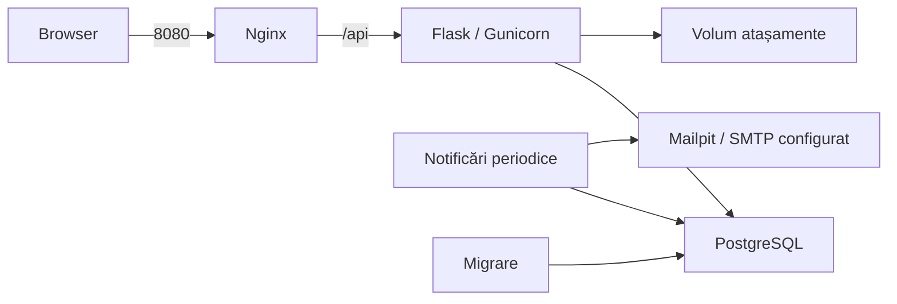

# Rulare Docker și mutare pe alt PC

## Pornire pe un PC nou

Pentru rulare sunt necesare Docker Desktop cu motorul Linux/WSL 2 și fișierele
repository-ului. Python și Node sunt instalate în imagini; nu sunt necesare pe
calculatorul gazdă pentru utilizarea portalului.

Din rădăcina proiectului, în PowerShell:

```powershell
Copy-Item .env.example .env
```

Completează `POSTGRES_PASSWORD` cu o parolă proprie și `JWT_SECRET_KEY` cu o
valoare aleatoare. O poți genera local, fără instalarea Python pe gazdă:

```powershell
docker run --rm python:3.14-slim python -c "import secrets; print(secrets.token_hex(32))"
```

Păstrează cheia în `.env`; acest fișier nu este inclus în Git sau în imaginile
aplicației. Nu suprascrie un `.env` deja configurat.

```powershell
docker compose --profile app up -d --build --wait
docker compose --profile app exec api python -m flask --app app create-admin
```

A doua comandă cere nume, email și parolă și creează primul administrator cu
audit. Dacă există deja un administrator, inițializarea este refuzată. Creezi
conturile echipelor din portal, cu butonul **Utilizator nou**.

- Portal: <http://127.0.0.1:8080>.
- Inbox local: <http://127.0.0.1:8025>.
- Disponibilitate: <http://127.0.0.1:8080/api/ready>.
- `WEB_PORT` schimbă portul portalului; implicit este `8080`.

Configurația livrată este pentru demonstrație locală, cu HTTP și
`JWT_COOKIE_SECURE=false`, iar porturile sunt legate de `127.0.0.1`.
Pentru publicare pe rețea este necesară configurarea HTTPS și a cookie-urilor
secure; nu se schimbă doar adresa de bind pentru a obține o instalare publică.

## Componente



| Serviciu | Rol |
| --- | --- |
| `web` | React compilat și Nginx; trimite `/api/` către Flask |
| `api` | Flask prin Gunicorn, cu un proces și patru fire |
| `migrate` | Aplică migrările, apoi se încheie cu succes |
| `db` | PostgreSQL 17 |
| `notification-worker` | Proces periodic, cu jurnal și deduplicare |
| `mailpit` | Inbox local; nu trimite emailuri către internet |
| `maintenance` | Utilitare pentru backup, restaurare și importul fișierelor |

API-ul pornește după migrare, iar portalul după verificarea API-ului.
`/api/health` verifică procesul; `/api/ready` verifică și accesul la tabela
migrărilor din baza de date. Serviciile `api` și `web` rulează fără root,
cu sistemul de fișiere al imaginii doar pentru citire și un `/tmp` temporar.

Gunicorn păstrează un singur proces deoarece limitarea încercărilor de login
folosește memorie locală procesului. Configurația nu pretinde că oferă limitare
distribuită între mai multe replici.

Nginx păstrează gazda și portul cererii, nu rescrie `Origin`, și înlocuiește
antetele de proxy primite de la client. `BEHIND_PROXY=true` este setat doar
pentru API-ul intern din Compose. API-ul nu publică direct portul Gunicorn.

## Date persistente și actualizare

`postgres_data` păstrează baza; `attachments_data` păstrează fișierele PDF și
imaginile. Numele efective ale volumelor includ proiectul Compose, de exemplu
`ruris_postgres_data`. Păstrează același nume de proiect când continui aceeași
instalare. Un nume nou înseamnă volume noi.

```powershell
docker compose --profile app down
docker compose --profile app up -d --build --wait
```

Oprirea de mai sus păstrează volumele. Copierea repository-ului pe alt PC
transferă codul; datele existente se transferă prin backup și restaurare.
Nu șterge volumele pentru a face o actualizare.

Frontendul folosește `npm ci` și `package-lock.json`. Imaginea Python folosește
`backend/requirements-container.lock`, generat în Linux din dependențele din
`requirements-container.txt`. Actualizarea versiunilor se face controlat,
cu reconstruire și testare; lockfile-ul include și dependențele tranzitive.

## Trecerea de la serverele locale la Docker

Baza existentă rămâne în același volum PostgreSQL. Fișierele locale trebuie
copiate separat înainte să pornești portalul Docker pentru acea bază.

1. Oprește Flask și Vite, precum și workerul care poate modifica aceeași bază.
2. Pornește doar baza: `docker compose up -d --wait db`.
3. Construiește imaginile: `docker compose --profile app build api web`.
4. Copiază fișierele locale într-un volum de atașamente gol:

```powershell
powershell.exe -NoProfile -ExecutionPolicy Bypass -File scripts/Import-LocalAttachments.ps1 -SourcePath .\instance\attachments
```

5. Pornește profilul `app`. Importul este o copiere, nu șterge sursa și refuză
   să suprascrie un volum de documente care conține deja fișiere.

Folosește calea configurată în `ATTACHMENT_STORAGE_PATH`, dacă este diferită.
În instalarea curentă, implicitul este `instance/attachments` din rădăcina
repository-ului. Nu rula simultan Flask local cu fișiere locale și API-ul Docker
cu fișiere în volum asupra aceleiași baze, deoarece spațiile lor de documente
ar fi diferite.

## Backup

Oprește orice server local care folosește aceeași bază, apoi:

```powershell
powershell.exe -NoProfile -ExecutionPolicy Bypass -File scripts/Backup.ps1
```

Opțiunea `ExecutionPolicy` se aplică doar procesului lansat, fără schimbarea
politicii PowerShell a sistemului. Pe un sistem care permite deja scripturile,
poți apela direct `./scripts/Backup.ps1`.

Scriptul oprește temporar API-ul, portalul și workerul care erau pornite,
verifică documentele, salvează datele și repornește serviciile în `finally`.
Se folosește backupul PostgreSQL în format custom, fără transfer binar prin
redirecționarea PowerShell.

În `backups/ruris-<data>-<identificator>/` apar:

- `database.dump`: schema aplicației `public`, inclusiv utilizatori, audit și jurnal email;
- `attachments.tar.gz`: documentele, inclusiv cele retrase;
- `manifest.txt`: format, proiect, bază, migrare și moment UTC;
- `SHA256SUMS`: verificarea integrității;
- `COMPLETE`: marker creat numai după finalizarea backupului.

Folderul este exclus din Git. Copiază backupul pe un mediu separat și păstrează-l
cu acces restricționat: conține datele aplicației. Configurația `.env` și mesajele
vizibile în Mailpit nu sunt incluse; istoricul emailurilor din portal este în bază.
Folosește numai backupuri proprii, de încredere; checksumurile detectează coruperea,
nu autentifică autorul arhivei.

## Restaurare pe alt PC sau în alt proiect

Copiază repository-ul și folderul backupului sub `backups/`. Configurează `.env`
și construiește imaginile, fără să inițializezi încă baza prin profilul `app`:

```powershell
docker compose --profile app build api web
powershell.exe -NoProfile -ExecutionPolicy Bypass -File scripts/Restore.ps1 -BackupName ruris-YYYYMMDD-HHMMSS-identificator -ProjectName ruris
docker compose --project-name ruris --profile app up -d --no-build --wait
```

Destinația trebuie să aibă baza și volumul de documente goale, iar serviciile
aplicației oprite. Restaurarea verifică markerul, checksumurile și căile arhivei
înainte să scrie; refuză suprascrierea datelor existente. Baza se restaurează
într-o singură tranzacție, apoi se recuperează fișierele, se aplică migrările
livrate și se verifică integritatea documentelor. O eroare oprește procedura;
nu porni portalul până nu trece verificarea.

Pe același PC, un proiect paralel are nevoie și de alte porturi pentru PostgreSQL,
Mailpit și portal. Scripturile acceptă `-EnvFile`, `-ProjectName` și `-DockerExe`.
Pentru comenzi Compose directe cu alt fișier, setează și `RURIS_ENV_FILE`:

```powershell
$env:RURIS_ENV_FILE = '.env.restore'
docker compose --env-file .env.restore --project-name ruris-restore --profile app up -d --no-build --wait
```

Scripturile PowerShell setează această variabilă numai în timpul comenzilor lor.

## Verificări și diagnostic

```powershell
docker compose --profile app ps
docker compose --profile app logs --tail 50 api web notification-worker migrate
docker compose --profile app exec api python -m flask --app app check-attachments
```

Scenariul Docker automat folosește o bază izolată `ruris_delivery`, porturi peste
18000 și conturi create exclusiv prin `backend/tests/docker_seed.py`. Configurația
Playwright pentru containere nu pornește Vite și nu interceptează API-ul.

```powershell
$env:RURIS_REAL_API = '1'
$env:RURIS_DOCKER_SMOKE = '1'
$env:RURIS_DOCKER_URL = 'http://127.0.0.1:18080'
cd frontend
npm.cmd test -- --config playwright.docker.config.js --grep 'warehouse evidence follows|100 ordered, 77'
```

După restaurare, pe URL-ul destinației, testul `restored Docker` verifică stocul,
factura plătită și octeții documentului descărcat. Aceste conturi sunt doar pentru
testul izolat; instalarea obișnuită folosește administratorul creat interactiv.

Pentru a include anularea în proba de backup, rulează și scenariul
`--grep 'cancelling a duplicate'` pe sursa izolată înainte de backup. Pe copia
restaurată setează `RURIS_DOCKER_CANCEL_RESTORE=1`, URL-ul destinației și rulează:

```powershell
npm.cmd test -- --config playwright.docker.config.js docker-restore.spec.js
```

Cele două teste verifică și motivul anulării, autorul, momentul, istoricul și
PDF-ul păstrat. Fără variabila suplimentară, testul specific anulării este omis.
Nu rula scenariile de creare de date de două ori în aceeași bază: referințele
demonstrative sunt fixe și protejate prin unicitate.

Surse pentru configurare: [ordinea de pornire Compose](https://docs.docker.com/compose/how-tos/startup-order/),
[Gunicorn cu Flask](https://flask.palletsprojects.com/en/stable/deploying/gunicorn/),
[proxy HTTP Nginx](https://nginx.org/en/docs/http/ngx_http_proxy_module.html).
