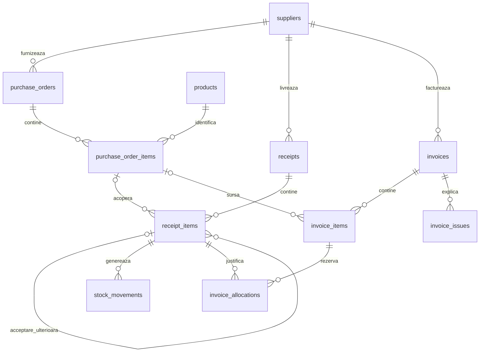

# Schema bazei de date

Schema implementată este definită de `backend/app/models` și migrările Alembic.
Versiunea curentă este `0025_invoice_cancellation`; nu folosim SQLite sau
`create_all` pentru instalarea aplicației.

## Relații principale

## Tabele implementate

| Grup | Tabele | Rol și reguli principale |
| --- | --- | --- |
| Acces | `users`, `revoked_tokens` | Email unic normalizat, hash bcrypt, rol, stare activă, versiune sesiune; revocare după identificatorul JWT, fără token complet |
| Catalog | `suppliers`, `products` | Cod fiscal normalizat unic pe țară; SKU unic, unitate de bază; referințe păstrate în documente |
| Achiziții | `purchase_orders`, `purchase_order_items` | Număr generat CA-id, responsabil și autor, versiune, furnizor, monedă, poziții cu descriere/preț/TVA/termen |
| Depozit | `receipts`, `receipt_items` | Număr REC-id, document de livrare, moment, versiune, confirmare; produs și comandă opționale pentru marfă neidentificată |
| Stoc | `stock_movements` | Numai intrări RECEIPT pozitive; produs, poziție de recepție, motiv, autor și cheie de operație unică; mișcări imuabile |
| Facturare | `invoices`, `invoice_items` | Referință unică furnizor + serie + număr normalizate; condiții pe poziții, totaluri calculate și declarate, versiune, curs, aprobare, plată și anulare |
| Asociere | `invoice_allocations` | Cantitate pozitivă, poziție factură și recepție; ACTIVE sau RELEASED, cu momentul eliberării |
| Blocaje | `invoice_issues` | Motiv, detalii, responsabil, poziție opțională, moment și rezolvare; istoricul rămâne |
| Curs | `exchange_rates` | Sursă, monedă, dată, curs, URL, SHA-256 și momentul preluării; cache unic și imuabil |
| Audit | `audit_events` | Autor uman sau proces, acțiune, entitate, înainte/după JSONB, motiv și moment; trigger împotriva UPDATE/DELETE |
| Email | `email_outbox`, `email_attempts` | Destinatar, tip, transport, zi, conținut și hash, stare și încercări; unicitate destinatar/tip/transport/zi |
| Fișiere | `attachments` | Exact un părinte comandă/recepție/factură; cheie aleatoare, nume original, tip, dimensiune, checksum, upload_key, autor și retragere |

Conținutul fișierelor este în volumul de atașamente, nu în PostgreSQL. Cheia de
stocare nu se construiește din numele furnizorului sau al fișierului. Nu există
tabel generic `idempotency_requests`: protecția la repetare este specifică
operației, prin versiune/stare, chei unice de stoc sau `upload_key` pentru fișiere.

## Cantități și legături

Pe poziția fizică a recepției:

`received_quantity = accepted_quantity + rejected_quantity + pending_quantity + resolved_quantity`.

`origin_item_id` leagă o acceptare ulterioară de poziția inițială.
`pending_order_item_id` păstrează propunerea comercială până la decizia Depozitului.
Copilul de acceptare are cantitatea integral acceptată și comanda sa; agregările
nu îl adună ca o a doua sosire fizică.

`invoice_items.purchase_order_item_id` păstrează sursa precompletării din comandă.
O factură introdusă manual se poate lega de comenzi prin asocieri și recepții.
Limitele cumulative se verifică în servicii tranzacționale, sub blocări de rând;
nu pot fi exprimate numai prin CHECK pe un singur rând.

## Stări și metadate

Factura poate fi DRAFT, BLOCKED, VERIFIED, APPROVED, PAID sau CANCELLED.
Anularea păstrează `cancelled_by_id`, `cancelled_at` și `cancellation_reason`.
Constrângerea bazei cere toate cele trei numai pentru CANCELLED și le interzice
pentru celelalte stări. Factura anulată nu se șterge și nu pierde unicitatea referinței.
Migrarea înapoi refuză eliminarea acestor date dacă există facturi anulate.

APPROVED și PAID păstrează autorul și momentul aprobării, respectiv al plății.
Plata are o referință; nu există tabel de tranșe sau integrare bancară.
Corecția facturilor deja aprobate/plătite nu este implementată.

Schema permite CLOSED/CANCELLED pentru comenzi și CANCELLED pentru recepții,
dar API-ul curent livrează crearea/corectarea ciornelor și confirmarea lor,
nu acțiuni generale de închidere sau anulare pentru aceste documente.
Nu există `closed_quantity`, tabele de retur sau tipuri de stoc pentru ieșiri și ajustări.

## Convenții de stocare

- Identificatori BIGINT generați de PostgreSQL și chei externe cu RESTRICT.
- Cantități NUMERIC(18, 3), prețuri NUMERIC(18, 4), sume NUMERIC(18, 2).
- TVA NUMERIC(5, 2), procent, de exemplu 19 pentru valoarea 19% de pe un document.
- Cursuri NUMERIC(18, 6); data facturii și a cursului sunt DATE.
- Momentele sunt TIMESTAMP WITH TIME ZONE; afișarea folosește Europe/Bucharest.
- `version` este incrementată la modificare și comparată cu versiunea din cerere.
- CHECK/NOT NULL/UNIQUE impun limitele locale, unicitatea și metadatele coerente.
- Auditul, cache-ul de cursuri și mișcările de stoc au protecții de imutabilitate.

Backupul include schema `public` și toate fișierele, inclusiv cele retrase.
`alembic_version` este inclusă în dump; schemele temporare de test nu sunt incluse.
Restaurarea aplică apoi eventualele migrări noi.
