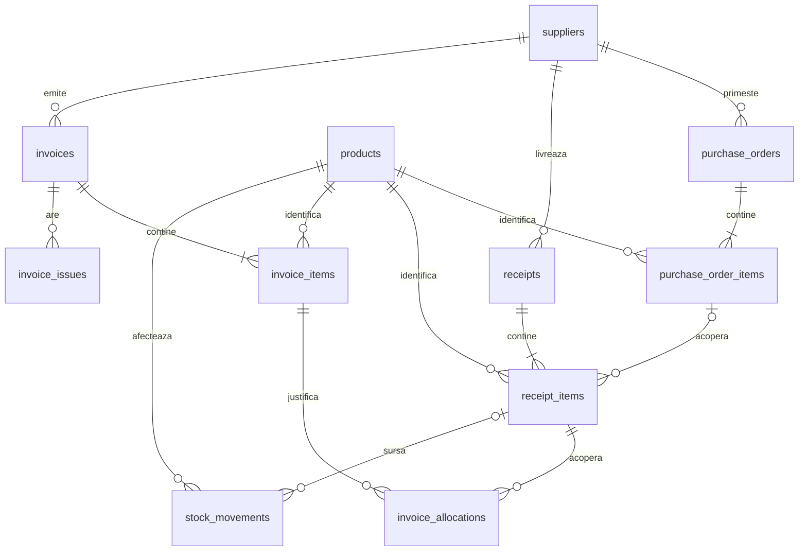

# Schema bazei de date

Schema propusa pentru prima versiune. Sunt implementate `users`, `audit_events`,
`revoked_tokens`, `suppliers`, `products`, `purchase_orders` si `purchase_order_items`.
Sunt implementate si `receipts` si `receipt_items`, pentru crearea, consultarea si corectarea
ciornelor (referinta, data si cantitatile pozitiilor existente),
legate la o singura comanda confirmata. Confirmarea receptiilor si intrarile in
`stock_movements` sunt implementate; momentan registrul accepta numai tipul RECEIPT.
Iesirile, retururile, soldul initial, ajustarile si campul reverses_id sunt planificate.
Pentru comenzi sunt implementate crearea/listarea/detaliul/editarea ciornelor si confirmarea.
Campurile `closed_quantity` si `close_reason` si operatiile de anulare/inchidere sunt planificate.
Sunt implementate `email_outbox` si `email_attempts` pentru sumarele locale de
intarzieri si facturi blocate,
cu unicitate tip/transport/zi/responsabil si jurnalul incercarilor.
Sunt implementate `invoices` si `invoice_items` pentru crearea si consultarea
ciornelor, inclusiv editare cu versiune si motiv obligatorii. Sunt implementate
crearea si consultarea `invoice_allocations` ACTIVE pentru marfa acceptata,
cu verificari cumulative si blocari ale pozitiilor receptiei.
Eliberarea alocarilor este implementata pentru facturi DRAFT, cu motiv, versiune,
momentul eliberarii si audit. Sunt implementate verificarea facturilor si
`invoice_issues`, cu motive deschise, rezolvate sau depasite de o corectare.
Sunt implementate cursurile istorice EUR/RON din BNR si conversia pastrata pe factura
la verificare. Aprobarea explicita, cu reverificare, autor si moment, este implementata.
Inregistrarea unei plati integrale este implementata pentru facturi APPROVED,
cu paid_at, paid_by_id, payment_reference si audit. Corectarea platii ramane planificata.
Restul tabelelor sunt planificate.
Implementam fiecare grup impreuna cu regulile si testele lui.

## Relatiile principale

`||` inseamna exact unul, `o{` inseamna zero sau mai multe,
iar `|{` inseamna unul sau mai multe. `|o` indica o legatura optionala.
Comenzile, receptiile si facturile confirmate trebuie sa aiba cel putin o pozitie.
O ciorna poate fi salvata fara pozitii; regula se verifica la confirmare.

Utilizatorii si tabelele auxiliare sunt descrise separat pentru a pastra diagrama lizibila.

## Identificare si acces

| Tabel | Campuri principale | Reguli |
| --- | --- | --- |
| users | id, name, email, password_hash, role, is_active, token_version, created_at, updated_at | Email normalizat unic; rol obligatoriu; conturile cu istoric se dezactiveaza |
| revoked_tokens | id, user_id, token_jti, expires_at, revoked_at | Identificator UUID unic; nu stocam tokenul complet; index pe expirare si utilizator |

Rolurile primei versiuni: ADMIN, ACHIZITII, DEPOZIT, CONTABILITATE.
Folosim o coloana cu valori controlate; nu introducem inca tabele pentru permisiuni configurabile.
`token_version` permite invalidarea sesiunilor unui cont, de exemplu dupa schimbarea parolei.
La fiecare cerere protejata se verifica si starea curenta a contului si rolul din baza.

## Catalog

| Tabel | Campuri principale | Reguli |
| --- | --- | --- |
| suppliers | id, name, tax_country, tax_id, email, is_active | Identificare unica dupa tara si cod fiscal normalizat |
| products | id, sku, name, unit, is_active | SKU unic; o singura unitate de baza per produs |

Numele sau pretul dintr-un document nu depind de modificarile ulterioare ale catalogului.
Produsele necunoscute se inregistreaza in catalog inainte de salvarea pozitiei de receptie.
Unitati diferite pentru acelasi produs necesita clarificare; nu facem conversii implicite.
Produsele si furnizorii folositi in documente se dezactiveaza, fara stergerea istoricului.

## Achizitii

| Tabel | Campuri principale | Reguli |
| --- | --- | --- |
| purchase_orders | id, number, supplier_id, currency, status, owner_id, created_by_id, confirmed_at, version | Numar intern unic; moneda RON sau EUR |
| purchase_order_items | id, purchase_order_id, line_number, product_id, description, unit, quantity, unit_price, vat_rate, expected_date, closed_quantity, close_reason | Pozitie unica in comanda; cantitate pozitiva; pret nenegativ |

`owner_id` este responsabilul din achizitii; `created_by_id` identifica autorul.
Starea documentului: DRAFT, CONFIRMED, CLOSED sau CANCELLED.
Restul de livrat se calculeaza din cantitatea comandata, receptiile acceptate,
corectiile relevante si cantitatea inchisa explicit.
`closed_quantity` este nenegativa si nu poate depasi restul de livrat.
Starea de livrare partiala/completa se calculeaza; nu o editam manual.

## Depozit

| Tabel | Campuri principale | Reguli |
| --- | --- | --- |
| receipts | id, number, supplier_id, delivery_reference, received_at, status, created_by_id, confirmed_by_id, confirmed_at, version | Numar intern unic; confirmare urmarita |
| receipt_items | id, receipt_id, line_number, product_id, purchase_order_item_id, description, unit, received_quantity, accepted_quantity, rejected_quantity, pending_quantity | Legatura la comanda optionala pentru marfa necomandata |
| stock_movements | id, product_id, receipt_item_id, kind, quantity_delta, reason, created_by_id, created_at, operation_key, reverses_id | Miscare nenula; cheie de operatie unica; corectiile refera miscarea initiala |

Toate cantitatile receptiei sunt nenegative, iar cantitatea sosita este pozitiva.
Cantitatea sosita = acceptata + respinsa + in asteptare.
Acceptarea necesita legatura la o pozitie de comanda compatibila si suficient rest deschis.
La clarificarea marfii necomandate se completeaza legatura si se pastreaza schimbarea in audit.
Acceptarea ulterioara genereaza doar miscarea pentru cantitatea nou acceptata.

Tipuri de miscari: OPENING, RECEIPT, ISSUE, RETURN, ADJUSTMENT, REVERSAL.
`quantity_delta` este pozitiva pentru intrare si negativa pentru iesire.
Soldul initial este o miscare OPENING, nu o valoare ascunsa pe produs.
Un retur catre furnizor refera pozitia receptiei; o iesire obisnuita nu necesita receptie sursa.
Corectiile si retururile raman limitate de cantitatile originale si influenteaza eligibilitatea pentru facturare.
Nu stergem miscari confirmate; inregistram miscari de corectie.

Stocul disponibil se calculeaza prin suma miscarilor per produs.
In prima versiune nu pastram si un sold editabil separat.
Pentru operatii simultane, toate scrierile de stoc blocheaza randul produsului
inainte sa verifice soldul si sa adauge miscarea.

## Contabilitate

| Tabel | Campuri principale | Reguli |
| --- | --- | --- |
| invoices | id, supplier_id, series, number, invoice_date, due_date, currency, net_amount, vat_amount, total_amount, exchange_rate_id, exchange_rate_value, exchange_rate_date, total_ron, status, created_by_id, approved_by_id, approved_at, paid_at, payment_reference, version | Unicitate furnizor + serie + numar, dupa normalizare |
| invoice_items | id, invoice_id, line_number, product_id, description, unit, quantity, unit_price, vat_rate, net_amount, vat_amount, total_amount | Pozitie unica in factura; cantitate pozitiva; valori nenegative |
| invoice_allocations | id, invoice_item_id, receipt_item_id, quantity, status, created_at, released_at | Cantitate pozitiva; stare ACTIVE sau RELEASED |
| invoice_issues | id, invoice_id, invoice_item_id, code, details, responsible_role, opened_at, resolved_at | Mai multe motive de blocare per factura; pozitia este optionala |

Starea facturii: DRAFT, BLOCKED, VERIFIED, APPROVED, PAID sau CANCELLED.
Motivele de blocare se pastreaza separat de stare.
Factura asteptand cursul este BLOCKED, cu motiv EXCHANGE_RATE_MISSING.
Factura PAID poate avea o problema noua de rezolvat, fara pierderea starii platii.

Legatura factura-comanda se obtine prin alocare, receptie si pozitia de comanda.
Aceasta permite o factura pentru mai multe comenzi ale aceluiasi furnizor.
Nu legam o factura doar la antetul unei singure comenzi.

La alocare blocam pozitia receptiei si verificam suma alocarilor ACTIVE
fata de cantitatea acceptata eligibila dupa retururi si corectii.
Verificam si ca suma alocata pozitiei de factura nu depaseste cantitatea facturata.
Furnizorul, produsul, unitatea, pretul si moneda trebuie sa corespunda regulilor.
Un pret gresit nu se corecteaza prin conversia valutara.
Alocarile, verificarea facturii si auditul se salveaza in aceeasi tranzactie.
Retururile si corectiile folosesc aceleasi blocari ca alocarile.

Pentru prima versiune, o factura se achita integral printr-o singura inregistrare.
`paid_at`, `paid_by_id` si `payment_reference` tin evidenta acesteia; nu reprezinta confirmare de la banca.
Nu introducem inca un tabel pentru transe de plata.

## Date auxiliare

| Tabel | Campuri principale | Reguli |
| --- | --- | --- |
| exchange_rates | id, currency, rate_date, rate, source, source_url, content_sha256, fetched_at | Implementat pentru BNR/EUR; unicitate sursa + moneda + data; UPDATE/DELETE interzise prin trigger |
| audit_events | id, actor_user_id, actor_process, action, entity_type, entity_id, before_data, after_data, reason, created_at | Autor uman sau proces; fara parole si tokenuri |
| email_outbox | id, kind, transport, as_of, recipient_user_id, recipient_email, subject, body, content_hash, status, attempt_count, last_error, sent_at, next_attempt_at, created_at, updated_at | Implementat pentru OVERDUE si BLOCKED_INVOICES / LOCAL_MAILPIT; unicitate utilizator + tip + transport + zi; reincercare programata in UTC |
| email_attempts | id, outbox_id, attempt_number, status, error_code, started_at, completed_at | Implementat; maxim 3 incercari, numar unic per mesaj |
| attachments | id, purchase_order_id, receipt_id, invoice_id, storage_key, original_name, media_type, size_bytes, uploaded_by_id, created_at | Exact un document parinte; acces verificat prin document |
| idempotency_requests | id, user_id, operation, request_key, request_hash, result_reference, created_at | Unicitate utilizator + operatie + cheie; continutul repetat trebuie sa corespunda |

Factura pastreaza cursul si data folosite, chiar daca sursa locala de cursuri se actualizeaza.
Pentru RON folosim valoarea 1; referinta la un curs extern poate lipsi.
Datele de audit folosesc JSONB pentru campurile schimbate, cu lista explicita de campuri permise.
Atasamentele au continutul in spatiul de fisiere; baza pastreaza doar metadatele.
Backupul va include baza de date si fisierele atasate.
Numarul facturii si numele original al fisierului nu sunt folosite drept cale de stocare.

## Conventii

- Identificatori: BIGINT generat de PostgreSQL; cheile externe au acelasi tip.
- Cantitati: NUMERIC(18, 3); preturi unitare: NUMERIC(18, 4).
- Sume monetare: NUMERIC(18, 2); cursuri: NUMERIC(18, 6).
- Date documente: DATE; momente de actiune: TIMESTAMP WITH TIME ZONE.
- TVA: NUMERIC(7, 4), stocat ca procent, de exemplu 19 pentru 19%.
- `version`: numar incrementat la modificare pentru detectarea editarilor concurente.
- Campurile obligatorii se impun prin NOT NULL, iar limitele locale prin CHECK.
- Indexam cheile externe si filtrele folosite pentru termene, blocaje si notificari.
- Documentele cu istoric nu se sterg in cascada.
- Schimbarile de stare trec prin serviciile aplicatiei si genereaza audit.

Tipurile si campurile exacte se fixeaza in migrarile fiecarui modul.
Relatiile intre tabele nu inlocuiesc verificarile cumulative din tranzactii.

## Ordinea implementarii

1. User si auditul pentru modificarile de cont.
2. Autentificare, revocarea sesiunilor si permisiuni.
3. Furnizori, produse si comenzi.
4. Receptii, miscari de stoc si protectia confirmarilor repetate.
5. Facturi, alocari si motive de blocare.
6. Cursuri, atasamente si notificari, pe masura ce fluxurile le necesita.

Prima migrare va contine doar modelele implementate in primul pas.
Nu generam acum toate tabelele si nu simulam migrarea prin SQLite.
